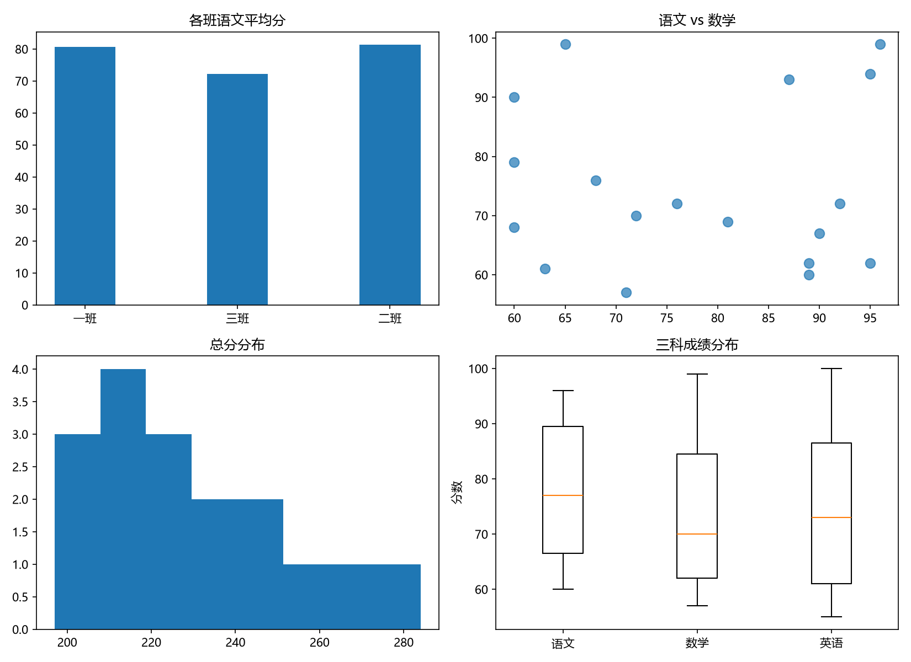

# week02 · 科学计算三件套

第二阶段：从纯 Python 过渡到 **NumPy → Pandas → Matplotlib**。

## 这是什么

我在 2026 年 9–10 月完成的三次练习，每篇都有配套的 HTML 教材。

| 天 | 主题 | 练习题 | 学到什么 |
|---|---|---|---|
| Day 11 | **NumPy** | 8 道 | 向量化、`shape`、索引、`axis`、`reshape`、`argmax` |
| Day 12 | **Pandas** | 10 道 | 读取、筛选、加列、排序、`groupby`、缺失值、导出 |
| Day 13 | **Matplotlib** | 7 道 | 折线、散点、柱状、直方图、箱线图、子图、保存 |

## 文件说明

```
day11.py              NumPy 的 8 道题
day12.py              Pandas 的 10 道题
day13.py              Matplotlib 的 7 道题
patch1.py  patch2.py  回归补丁练习（停学两周后补手感的）
self_test_answers.py  回归自测的答题记录
students.csv          练习题用的数据集（20 个学生 × 3 科，故意留了 3 个缺失值）
my_charts.png         Day 13 的最终产出：2×2 数据分析总览图
```

## 最终产出



四个子图分别是：各班语文平均分、语文 vs 数学散点、总分分布、三科箱线图。

## 环境

```bash
python -m venv .venv
.venv\Scripts\activate
pip install numpy pandas matplotlib
```

Python 3.13，numpy 2.5.3 / pandas 3.0.6 / matplotlib 3.11.2。

## 几个踩过的坑

1. **中文变方框** —— matplotlib 默认字体没有中文字形
   ```python
   plt.rcParams['font.sans-serif'] = ['Microsoft YaHei']
   plt.rcParams['axes.unicode_minus'] = False
   ```
2. **`savefig` 的顺序** —— 必须在所有画图代码之后，否则存下来的图会缺东西
3. **`to_csv` 返回 `None`** —— 不要赋值回去
4. **对比实验要各用各的变量** —— 覆盖原数据会让实验失效
5. **缺失值有三种语义** —— 不算 / 按已考算 / 当 0 分，选哪个都行但必须知道自己在选

## 相关

- 第一阶段（Python 基础）：[week01](https://github.com/Rhys-WW/week01)
